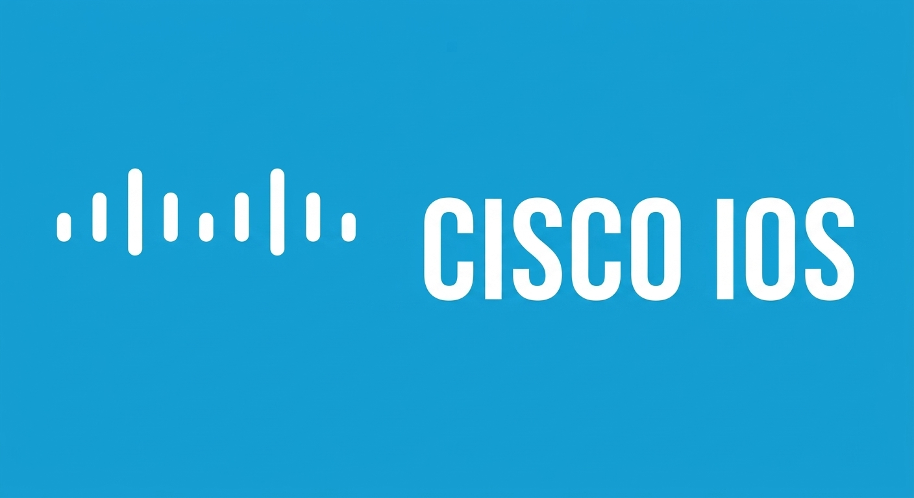
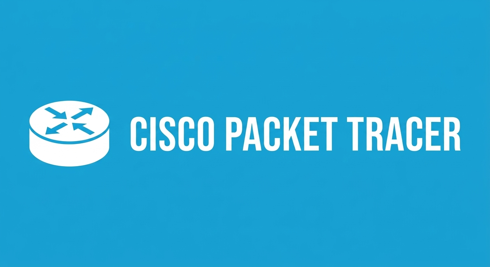
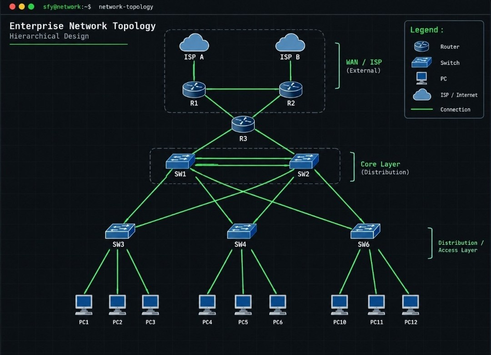
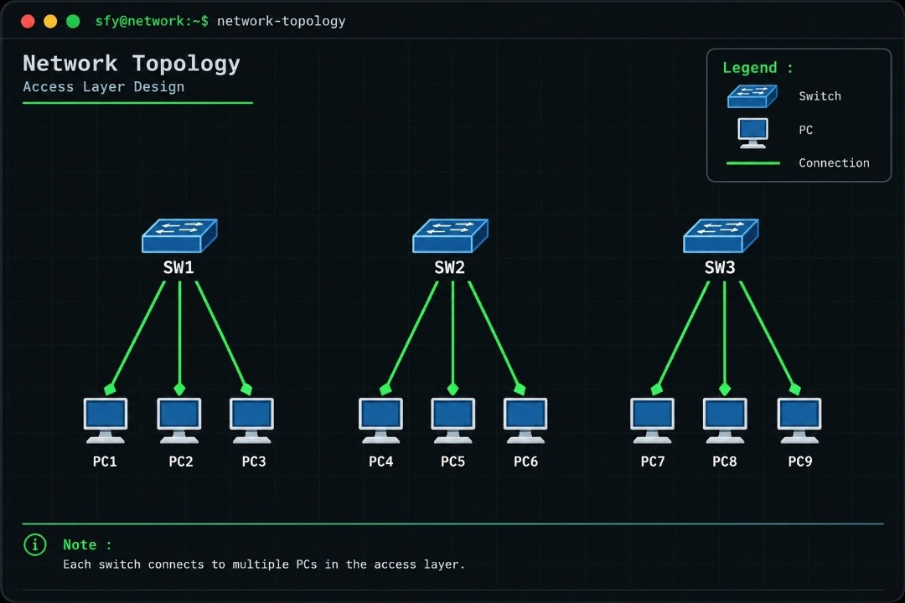
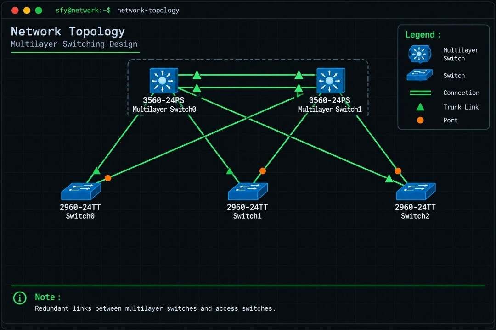
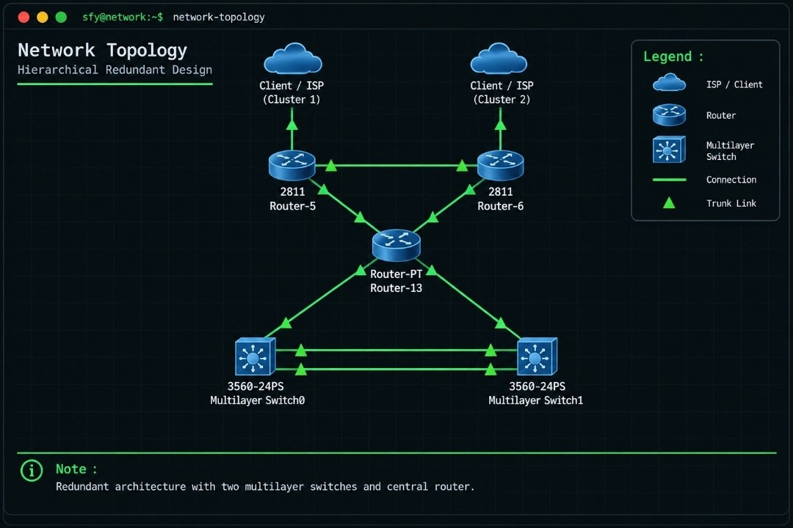

### `safa@network:~$ whoami`

Halo! Saya **Safa**, seorang *Network Engineering Enthusiast* yang berfokus pada desain arsitektur jaringan perusahaan (*Enterprise Network*), *Routing & Switching*, *High Availability*, dan keamanan infrastruktur jaringan.

---

### 🛠️ Keahlian & Teknologi Jaringan (Tech Stack)

  
  
  

* **Layer 2 Switching:** VLAN, 802.1Q Trunking, LACP EtherChannel, Rapid PVST+ (RSTP)
* **Layer 3 Routing & Redundancy:** Inter-VLAN Routing (SVI), OSPF Area 0, HSRP (Gateway Failover), DHCP Split-Scope
* **WAN & Network Security:** Dual-ISP Failover (Floating Static Route), NAT Overload (PAT), Extended IPv4 ACL

---

### 🚀 Proyek Unggulan: Enterprise High-Availability Network Topology

  

| Bagian 1: Access Layer | Bagian 2: Multilayer Switching | Bagian 3: Core & WAN Redundancy |
| :---: | :---: | :---: |
|  |  |  |
| Segmentasi VLAN (10, 20, 30) & 802.1Q Trunking | LACP EtherChannel, RSTP, SVI, HSRP & DHCP Split-Scope | OSPF Area 0, Dual-ISP Failover (AD 200), NAT PAT & Extended ACL |

👉 **[Lihat Dokumentasi Lengkap & Sintaks Cisco IOS di Sini](https://github.com)**
